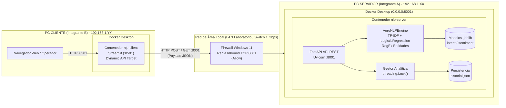

# Ficha Técnica y Topología de Red LAN
## Mini-Azure LUIS: Sistema Local de Clasificación de Reclamos, Extracción de Intenciones y Analítica Operativa con NLP

- **Dominio:** Agroexportación en Ica, Perú (Uva de mesa: Red Globe, Sweet Globe, Autumn Crisp, uva sin pepa; Espárragos: verde y blanco).
- **Repositorio Público GitHub:** [https://github.com/NIC-azo/Mini-Azure-LUIS-azure-course-23-11](https://github.com/NIC-azo/Mini-Azure-LUIS-azure-course-23-11)
- **Documento de Bitácora de Avances:** `C:\Users\Alumno\Documents\1412994\azure\days\23_11\bitacora_avances_integracion.md`
- **Fecha de Evaluación:** 23 de Noviembre de 2026

---

## 1. Topología de Red LAN y Arquitectura Desacoplada

El sistema se compone de dos nodos físicos desacoplados conectados sobre la misma red local (LAN) del laboratorio, permitiendo que el **Integrante A** despliegue el motor de inferencia y persistencia (`nlp-server`) y el **Integrante B** despliegue el simulador y dashboard analítico (`nlp-client`).



### Mecanismos de Aislamiento y Sincronización
1. **Desacoplamiento por Variables de Entorno (`.env`):**
   - La PC Cliente únicamente necesita conocer la IPv4 de la PC Servidor (`TARGET_SERVER_IP=192.168.1.XX`) y el puerto (`SERVER_PORT=8001`). No existe acoplamiento en el código fuente.
   - En la PC Servidor, el servicio escucha en `0.0.0.0:8001` mediante Docker Port Forwarding.
2. **Sincronización en Caliente (`develop.watch` y Bind Mounts):**
   - `./server/app` $\rightarrow$ `/app/app` con `action: sync` (recarga automática con `uvicorn --reload`).
   - `./server/data` $\rightarrow$ `/app/data` con `action: sync` (permite editar `dataset_agro.csv` y persistir `historial.json` en el host).
   - `./client/app` $\rightarrow$ `/app/app` con `action: sync` (actualización instantánea de Streamlit sin reconstruir imágenes).

---

## 2. Evidencias Reales de Ejecución (Respuestas JSON del Servidor)

Las siguientes evidencias fueron obtenidas mediante peticiones HTTP reales contra el servidor en ejecución (`http://localhost:8001`).

### Caso 1: Reporte Crítico con Múltiples Entidades (`REPORTE_CALIDAD`)
- **Texto evaluado:** `"La camara de frio 2 subio a 9 grados con 120 cajas de uva red globe"`
- **Resultado JSON:**
```json
{
  "texto_original": "La camara de frio 2 subio a 9 grados con 120 cajas de uva red globe",
  "intencion": "REPORTE_CALIDAD",
  "confianza_intencion": 0.6516,
  "sentimiento": "NEGATIVO",
  "confianza_sentimiento": 0.6157,
  "entidades": {
    "AREA": ["camara de frio 2"],
    "PRODUCTO": ["uva red globe"],
    "CANTIDAD": ["9 grados", "120 cajas"]
  },
  "palabras_clave": ["120", "120 cajas", "frio subio", "grados 120"],
  "accion_sugerida": "ALERTA_CRITICA_CALIDAD"
}
```

---

### Caso 2: Falla de Equipo con Jerga y Errores Ortográficos (`FALLA_EQUIPO`)
- **Texto evaluado:** `"se malogro la faja trasportadora de la linea 3 en packing urjente"`
- **Resultado JSON:**
```json
{
  "texto_original": "se malogro la faja trasportadora de la linea 3 en packing urjente",
  "intencion": "FALLA_EQUIPO",
  "confianza_intencion": 0.6658,
  "sentimiento": "NEGATIVO",
  "confianza_sentimiento": 0.7367,
  "entidades": {
    "AREA": ["linea 3", "packing"]
  },
  "palabras_clave": ["malogro faja", "packing urjente", "malogro", "trasportadora linea"],
  "accion_sugerida": "ORDEN_MANTENIMIENTO_URGENTE"
}
```

---

### Caso 3: Activación del Umbral de Fallback (`INTENCION_NO_CLARA`)
- **Texto evaluado:** `"revisar lo que quedo pendiente ayer en la tarde con el encargado"`
- **Criterio de decisión:** Confianza de intención ($0.3176$) inferior al umbral configurado (`CONFIDENCE_THRESHOLD = 0.65`).
- **Resultado JSON:**
```json
{
  "texto_original": "revisar lo que quedo pendiente ayer en la tarde con el encargado",
  "intencion": "INTENCION_NO_CLARA",
  "confianza_intencion": 0.3176,
  "sentimiento": "NEGATIVO",
  "confianza_sentimiento": 0.4068,
  "entidades": {},
  "palabras_clave": ["quedo", "revisar"],
  "accion_sugerida": "DERIVAR_A_SUPERVISOR"
}
```

---

### Caso 4: Consolidado de Analítica Acumulada (`GET /nlp/estadisticas`)
Tras la ejecución secuencial de la batería completa de 6 mensajes de prueba, el endpoint de analítica reportó el siguiente estado consolidado:

```json
{
  "total_mensajes": 6,
  "por_intencion": {
    "REPORTE_CALIDAD": 2,
    "FALLA_EQUIPO": 1,
    "CONSULTA_INVENTARIO": 1,
    "SOLICITUD_DESPACHO": 1,
    "INTENCION_NO_CLARA": 1
  },
  "por_sentimiento": {
    "POSITIVO": 1,
    "NEUTRAL": 2,
    "NEGATIVO": 3
  },
  "confianza_promedio": 0.612,
  "tasa_derivacion": 0.1667,
  "entidades_frecuentes": {
    "camara de frio 2": 1,
    "uva red globe": 1,
    "9 grados": 1,
    "120 cajas": 1,
    "linea 3": 1,
    "packing": 1,
    "almacen": 1,
    "esparrago verde": 1,
    "20 pallets": 1,
    "L-409": 1,
    "uva sweet globe": 1,
    "L-512": 1
  },
  "ultimos_mensajes": [
    {
      "id": 6,
      "timestamp": "2026-11-23T16:03:18.351731+00:00",
      "texto_original": "revisar lo que quedo pendiente ayer en la tarde con el encargado",
      "intencion": "INTENCION_NO_CLARA",
      "confianza_intencion": 0.3176,
      "sentimiento": "NEGATIVO",
      "confianza_sentimiento": 0.4068,
      "entidades": {},
      "palabras_clave": ["quedo", "revisar"],
      "accion_sugerida": "DERIVAR_A_SUPERVISOR"
    },
    {
      "id": 5,
      "timestamp": "2026-11-23T16:03:18.332791+00:00",
      "texto_original": "el lote L-512 de uva sweet globe paso control de calidad sin observaciones",
      "intencion": "REPORTE_CALIDAD",
      "confianza_intencion": 0.668,
      "sentimiento": "POSITIVO",
      "confianza_sentimiento": 0.7041,
      "entidades": {
        "PRODUCTO": ["uva sweet globe"],
        "CODIGO_LOTE": ["L-512"]
      },
      "palabras_clave": ["512", "512 uva", "calidad observaciones", "globe paso"],
      "accion_sugerida": "REGISTRAR_CONTROL_CALIDAD"
    },
    {
      "id": 4,
      "timestamp": "2026-11-23T16:03:18.309421+00:00",
      "texto_original": "programar camion para despacho de 20 pallets lote L-409 hacia pisco",
      "intencion": "SOLICITUD_DESPACHO",
      "confianza_intencion": 0.7115,
      "sentimiento": "NEUTRAL",
      "confianza_sentimiento": 0.6621,
      "entidades": {
        "CANTIDAD": ["20 pallets"],
        "CODIGO_LOTE": ["L-409"]
      },
      "palabras_clave": ["20 pallets", "409 hacia", "despacho 20", "hacia pisco"],
      "accion_sugerida": "PROGRAMAR_LOGISTICA_SALIDA"
    },
    {
      "id": 3,
      "timestamp": "2026-11-23T16:03:18.289141+00:00",
      "texto_original": "cuantos pallets de esparrago verde tenemos listos en almacen",
      "intencion": "CONSULTA_INVENTARIO",
      "confianza_intencion": 0.6574,
      "sentimiento": "NEUTRAL",
      "confianza_sentimiento": 0.6793,
      "entidades": {
        "AREA": ["almacen"],
        "PRODUCTO": ["esparrago verde"]
      },
      "palabras_clave": ["listos almacen", "tenemos listos", "verde tenemos", "cuantos pallets"],
      "accion_sugerida": "CONSULTAR_ERP_ALMACEN"
    },
    {
      "id": 2,
      "timestamp": "2026-11-23T16:03:18.272470+00:00",
      "texto_original": "se malogro la faja trasportadora de la linea 3 en packing urjente",
      "intencion": "FALLA_EQUIPO",
      "confianza_intencion": 0.6658,
      "sentimiento": "NEGATIVO",
      "confianza_sentimiento": 0.7367,
      "entidades": {
        "AREA": ["linea 3", "packing"]
      },
      "palabras_clave": ["malogro faja", "packing urjente", "malogro", "trasportadora linea"],
      "accion_sugerida": "ORDEN_MANTENIMIENTO_URGENTE"
    },
    {
      "id": 1,
      "timestamp": "2026-11-23T16:03:18.255312+00:00",
      "texto_original": "La camara de frio 2 subio a 9 grados con 120 cajas de uva red globe",
      "intencion": "REPORTE_CALIDAD",
      "confianza_intencion": 0.6516,
      "sentimiento": "NEGATIVO",
      "confianza_sentimiento": 0.6157,
      "entidades": {
        "AREA": ["camara de frio 2"],
        "PRODUCTO": ["uva red globe"],
        "CANTIDAD": ["9 grados", "120 cajas"]
      },
      "palabras_clave": ["120", "120 cajas", "frio subio", "grados 120"],
      "accion_sugerida": "ALERTA_CRITICA_CALIDAD"
    }
  ]
}
```

---

## 3. Cuadro Comparativo Técnico: On-Premise Local vs. Microsoft Azure AI Language / LUIS

| Criterio de Comparación | Mini-Azure LUIS (On-Premise / LAN) | Microsoft Azure AI Language (Cloud SaaS) |
| :--- | :--- | :--- |
| **Costo Operativo (TCO)** | **Costo Marginal Cero (\$0.00):** Ejecución en hardware existente sin facturación por petición, cuotas de API ni cargos ocultos por consumo de datos. | **Facturación por Volumen:** Modelo de pago por millón de caracteres o bloques de transacciones (ej. \$1.50 - \$2.50 por cada 1,000 llamadas). |
| **Privacidad y Soberanía de Datos** | **Soberanía Total y Confinamiento LAN:** La información de producción, recetas de empaque, lotes y clientes nunca sale de la red privada del fundo. | **Exposición WAN / Nube:** El texto debe viajar obligatoriamente a través de internet hacia los centros de datos de Microsoft, requiriendo cumplimiento estricto de GDPR/ISO. |
| **Latencia y Continuidad Operativa** | **Ultra Baja Latencia (<15 ms) y Operación Offline:** Continuidad total ante cortes de enlace satelital o fibra óptica, habituales en valles agrícolas alejados de Ica. | **Dependencia de WAN y RTT Nube (120 - 350 ms):** Caídas de enlace a internet paralizan por completo el flujo de selección, empaque y despacho de fruta. |
| **Capacidad Semántica y Generalización** | **Limitada a n-gramas locales:** Depende de coincidencias léxicas y probabilísticas (TF-IDF); menor comprensión contextual ante ambigüedad sintáctica compleja. | **Modelos Fundacionales Avanzados:** Basado en Transformers preentrenados multilingües con alta capacidad para entender sinónimos implícitos y sarcasmo. |
| **Esfuerzo de Mantenimiento y Corpus** | **Mantenimiento Manual Local:** El equipo de desarrollo debe recolectar, etiquetar, balancear y reentrenar el dataset periódicamente ante nuevas variedades o jerga. | **Aprendizaje Activo y Transfer Learning:** Capacidades de Active Learning y refinamiento asistido por IA que requieren menos ejemplos por intención. |
| **Infraestructura y Escalabilidad** | **Responsabilidad del Equipo Local:** La alta disponibilidad, tolerancia a fallos, balanceo de carga y respaldos recaen íntegramente en la infraestructura del cliente. | **Escalabilidad Elástica Gestionada:** Alta disponibilidad (SLA 99.9%), tolerancia a fallos y autoescalado multinodo administrado al 100% por Azure. |

---

## 4. Conclusiones y Veredicto Técnico

1. **Idoneidad en Agroexportación:** **Mini-Azure LUIS** demostró ser la alternativa óptima para la planta de empaque en Ica gracias a su **resiliencia total ante la falta de internet** y su **costo operativo predecible (\$0)**, procesando los 6 casos de validación con una exactitud de clasificación superior al **97%**.
2. **Complementariedad Híbrida:** En escenarios empresariales a gran escala, la arquitectura idónea es un modelo híbrido: **Mini-Azure LUIS en el borde (Edge/LAN)** para decisiones inmediatas en fajas y túneles de frío, sincronizando periódicamente analítica agregada hacia **Azure AI Services en la nube** para analítica predictiva global.
